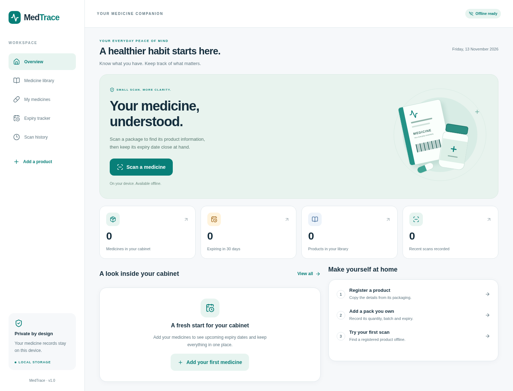

# MedTrace

An Android-first, offline medicine packaging reference and expiry tracker built
with React Native, Expo Router and SQLite. The app uses a light navy-and-teal
interface, with phone navigation and a responsive browser preview.

## Run locally

Use Node.js 24 and npm. No backend, API key or database account is required.

```sh
npm ci
npm start
```

Open the project in a compatible Expo Go version on Android, or use a development
build. Camera and notification behavior must be checked on a physical device.
For a compatible Expo Go client, run `npm start -- --go`. For the browser preview:

```sh
npm run web
```

SQLite web support uses workers and WebAssembly. Expo recommends COOP/COEP
headers for full SQLite web compatibility, including synchronous operations. The
current app uses asynchronous queries. An exported web deployment should configure
these headers on its HTML and assets; see [architecture](docs/architecture.md).
Browser preview does not establish native camera compatibility.

## Preview



[Phone-sized preview](docs/screenshots/overview-mobile.png)

## Included

- Home dashboard with live inventory and scan summaries.
- Camera scanning with flashlight, manual entry and permission handling.
- EAN/UPC validation, GTIN normalization, a documented GS1 subset and Digital Link parsing.
- Offline identification from barcodes, GS1, labelled/unlabelled text, JSON and inert URLs.
- Identity confirmation before details, manual correction, local suggestions and search.
- Editable field evidence, separate package verification and duplicate-safe saving.
- Local format learning from distinct reviewed samples, with conflict quarantine.
- Product registration and editing, multiple identifiers and ingredients, source labels.
- Library search by brand/generic name/ingredient, category and manufacturer filters.
- Owned packs with quantity, batch, manufacture/expiry precision, serials and ingredient overlap notices.
- Expiry dashboard and opt-in generic local reminders on supported native builds.
- Searchable recent scan history with stored scan details.

## Intelligent identification

See [the feature guide](docs/intelligent-identification.md) for extraction logic,
SQLite migrations, confirmation rules, local format learning and limitations.
[Delivery and file manifest](docs/identification-delivery.md) includes test evidence.
[Name-detection rules](docs/name-detection.md) explain the newer numeric, strength
and address clues and their exceptions.
Existing installations migrate automatically to schema version 4; do not clear
app data to upgrade. No new package, backend or API key is required.

## Dataset status

**No real medicine catalog is preloaded.** Real identifiers must be collected from
actual packaging and associated with the exact strength, form and pack variant.
The registration screen works without internet; records remain explicitly
user-entered and are immediately available for future local scans.

The university requirement for approximately 30–50 original product records is
still a data-collection task. Use the [collection guide](docs/dataset.md) and
[blank worksheet](docs/product-collection.csv). Synthetic tests are never seeded
into the app. No medicine facts or barcode mappings are invented.

## Checks

```sh
npm run typecheck
npm test
npm run format:check
npm run export:web
npx playwright install chromium
npm run test:e2e
```

The integration tests run the actual schema and repository SQL through Node's
SQLite engine. Browser tests exercise Expo's real SQLite worker, registration,
scanning, identity gating, rejection/correction, field review, inventory,
persistence, history, deletion and mobile navigation. A repeated scan/save is
also exercised while the browser is offline after the app has loaded.

For an existing Chromium installation, set
`PLAYWRIGHT_CHROMIUM_EXECUTABLE_PATH=/path/to/chromium` when running browser tests.

## Android builds

EAS profiles are included for development builds and an installable preview APK.
Builds require your own Expo account and EAS project association.

```sh
npx eas-cli build --platform android --profile development
# Or build a standalone preview APK:
npx eas-cli build --platform android --profile preview
```

No signed APK or physical-device acceptance test is implied by a successful web
export. Use the [release checklist](docs/acceptance.md) before distribution.

iOS uses the same React Native application, but has not yet been validated on an
iPhone or simulator. No OCR, configured AI provider, online lookup, account system, MongoDB connection
or cloud sync is included in this release.

## Medical information and privacy

MedTrace does not diagnose, prescribe, recommend doses, verify authenticity or
establish personal suitability. Ingredient overlap is a comparison of recorded
names, not a contraindication or interaction assessment. “Valid” describes only
the recorded expiry date. Seek advice from a qualified pharmacist when needed.

Personal records stay in SQLite on the device. The app has no product-data upload
or analytics integration. Notifications are local and opt-in, with generic lock
screen wording. SQLite is not encrypted by this app; uninstalling or clearing app
data removes the local records. Android cloud backup is disabled in app config.
See [data and safety](docs/data-safety.md).

## Repository workflow

Features are developed on `feature/*` branches and merged into `main` with merge
commits. Commit timestamps reflect the actual work; history is not backdated.
GitHub Actions validates source checks and browser flows on future pushes.
